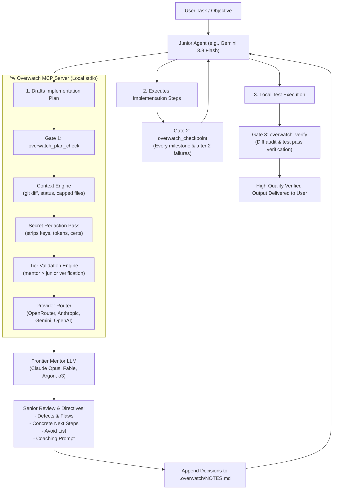

# 🛰️ Overwatch

> **Steer fast, cheaper AI coding models with frontier mentor models at mandatory architectural checkpoints.**

[](https://github.com/overwatch/overwatch/actions/workflows/ci.yml)
[](LICENSE)
[](https://modelcontextprotocol.io)

---

## The Pitch

When you run an autonomous AI pair programmer (in **Antigravity**, **Claude Code**, **Cursor**, **Windsurf**, or **VS Code**), using a high-throughput, cheaper model (like **Gemini 3.8 Flash**, **Claude 3.5 Haiku**, or **GPT-4o-mini**) keeps costs low and iterations rapid.

However, smaller models have a critical weakness: **they are poorly calibrated about when they need help**. They can hallucinate non-existent APIs, introduce subtle race conditions, miss edge cases, and thrash in debug loops without realizing it.

**Overwatch** introduces a **Senior Architect in the Loop**:
- A fast junior model does the execution work in your IDE or terminal.
- A frontier mentor model (**Claude Opus 5.5 / 4.5**, **Fable 5.1**, **Gemini 4-Argon / Astra**, **OpenAI o3 / o1**) **steers** the junior model at **mandatory checkpoints**.
- The mentor critiques the plan, dictates the next 3-5 concrete steps, provides an anti-pattern avoid list, and produces an executable coaching prompt.
- Work is verified against real `git diff` and test results before being declared done.



---

## Non-Negotiable Checkpoints

Weak models are bad at judging when to ask for help. Overwatch replaces judgment calls with **strict, mandatory gates**:

1. **Pre-Implementation Gate (`overwatch_plan_check`)**:
   Must be called immediately after planning, before writing a single line of code.
2. **Steering Gate (`overwatch_checkpoint`)**:
   Must be called after each major milestone, and **immediately after 2 consecutive failures** to break debug loops.
3. **Completion Gate (`overwatch_verify`)**:
   Must be called with real test outputs before claiming the task is complete.
4. **Shared Memory (`.overwatch/NOTES.md`)**:
   The server appends mentor decisions, architectural constraints, and rejected alternatives. The junior reads this at the start of every iteration.

---

## Quickstart & Installation

Install and configure Overwatch in any supported agent with a single command:

```bash
# Using npx (zero installation)
npx overwatch setup --client antigravity
```

### Supported Clients

Client | Registration Location | Status
:--- | :--- | :---
**Antigravity** | `~/.gemini/config/mcp_config.json` & `skills/overwatch/` | ✅ Docs-Verified
**Claude Code** | `~/.claude.json` (`mcpServers`) & `CLAUDE.md` | ✅ Docs-Verified
**Cursor** | `~/.cursor/mcp.json` & `.cursorrules` | ✅ Docs-Verified
**Windsurf** | `~/.codeium/windsurf/mcp_config.json` & `.windsurfrules` | ✅ Docs-Verified
**VS Code (Cline)** | `cline_mcp_settings.json` (macOS, Windows, Linux) | ✅ Docs-Verified
**Codex** | Manual CLI registration: `codex mcp add overwatch -- overwatch serve` | 📝 Manual

You can also install across all detected clients at once:
```bash
npx overwatch setup --client all
```

---

## Provider Setup

Overwatch supports direct API credentials or unified routing:

1. **OpenRouter (Recommended)**:
   Access Claude Opus, Gemini Argon, Fable, o3, and DeepSeek with one key:
   ```bash
   export OPENROUTER_API_KEY="sk-or-v1-..."
   ```

2. **Direct Anthropic**:
   Includes automatic prompt caching and extended thinking for Claude Opus/Sonnet:
   ```bash
   export ANTHROPIC_API_KEY="sk-ant-..."
   ```

3. **Direct Google Gemini**:
   Connects to Gemini 4-Argon and Gemini Astra:
   ```bash
   export GEMINI_API_KEY="AIzaSy..."
   ```

4. **Direct OpenAI / Custom Endpoints**:
   Connects to OpenAI o3/o1 or local Ollama / vLLM / LiteLLM instances:
   ```bash
   export OPENAI_API_KEY="sk-..."
   export OPENAI_BASE_URL="http://localhost:11434/v1" # Optional for local Ollama
   ```

Run the interactive wizard to save your keys:
```bash
npx overwatch configure
```

---

## Tier Validation ("Mentor Must Be Stronger")

Overwatch includes a built-in tier verification engine (`models.json`):
- **`frontier`**: Claude Opus 5.5 / 4.5, Fable 5.1, Gemini 4-Argon, Gemini Astra, OpenAI o3, o1.
- **`strong`**: Claude 3.7 Sonnet, DeepSeek R1, GPT-4o, Gemini 3.5 Pro.
- **`medium`**: Gemini 3.8 Flash, Claude 3.5 Haiku, GPT-4o-mini.
- **`small`**: Gemini Flash 8B, GPT-3.5-Turbo, Qwen-2.5-Coder-7B.

If your configured mentor model is not strictly higher in tier than your junior model, `overwatch doctor` and `overwatch configure` will warn loudly.

---

## Diagnostics & Health Check

Run the built-in diagnostic suite:
```bash
npx overwatch doctor
```
Outputs Node environment, config permissions, API key presence (masked), live latency ping to your mentor model, model tier status, and client registrations.

---

## Privacy & Safety Guardrails

- **Zero Telemetry**: Overwatch contains no tracking, telemetry, or external analytics of any kind.
- **Secret Redaction Pass**: All outgoing content is automatically scrubbed of API keys, bearer tokens, AWS credentials, GitHub tokens, and private SSH/RSA keys before being sent to mentor APIs.
- **Excluded Files**: `.env*`, `*.pem`, `*.key`, `*.crt`, and credentials are never read or transmitted.
- **Path-Traversal Guard**: File reading strictly verifies directory containment and resolves symlinks to prevent escapes outside `repo_path`.
- **Stdio Hygiene**: All diagnostic logging is routed strictly to `stderr`. `stdout` is reserved exclusively for clean JSON-RPC protocol frames.

---

## Cost Controls

- **Per-Session Call Cap**: Configured to ~15 calls per session by default. When reached, the junior agent is instructed to proceed independently.
- **Spend Tracking**: Real-time token usage and cost tracking in `.overwatch/usage.json`.
- Check spend at any time:
  ```bash
  npx overwatch stats
  ```

---

## Benchmark & Evaluation

Read [`docs/EVAL.md`](docs/EVAL.md) for our empirical evaluation protocol comparing Junior-alone vs. Junior+Overwatch.

---

## License

MIT © 2026 Overwatch Contributors.
