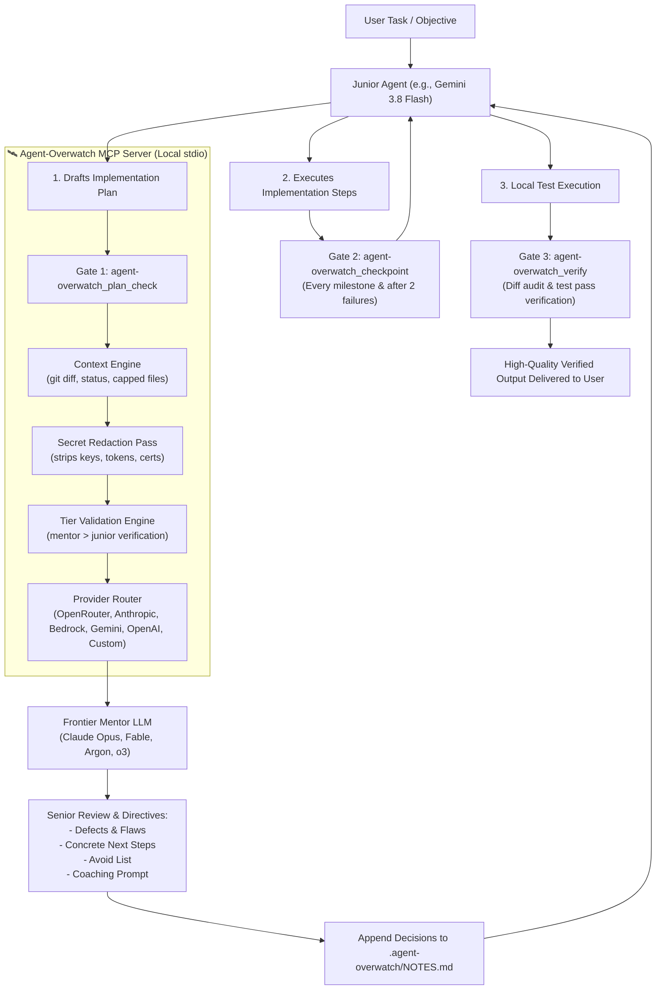

# 🛰️ Agent-Overwatch

> **Steer fast, cheaper AI coding models with frontier mentor models at mandatory architectural checkpoints.**

[](https://github.com/faisalforreal/agent-overwatch/actions/workflows/ci.yml)
[](LICENSE)
[](https://modelcontextprotocol.io)

---

## The Pitch

When you run an autonomous AI pair programmer (in **Antigravity**, **Claude Code**, **Cursor**, **Windsurf**, or **VS Code**), using a high-throughput, cheaper model (like **Gemini 3.8 Flash**, **Claude 3.5 Haiku**, or **GPT-4o-mini**) keeps costs low and iterations rapid.

However, smaller models have a critical weakness: **they are poorly calibrated about when they need help**. They can hallucinate non-existent APIs, introduce subtle race conditions, miss edge cases, and thrash in debug loops without realizing it.

**Agent-Overwatch** introduces a **Senior Architect in the Loop**:
- A fast junior model does the execution work in your IDE or terminal.
- A frontier mentor model (**Claude Opus 5.5 / 4.5**, **Fable 5.1**, **Gemini 4-Argon / Astra**, **OpenAI o3 / o1**) **steers** the junior model at **mandatory checkpoints**.
- The mentor critiques the plan, dictates the next 3-5 concrete steps, provides an anti-pattern avoid list, and produces an executable coaching prompt.
- Work is verified against real `git diff` and test results before being declared done.



---

## Non-Negotiable Checkpoints

Weak models are bad at judging when to ask for help. Agent-Overwatch replaces judgment calls with **strict, mandatory gates**:

1. **Pre-Implementation Gate (`agent-overwatch_plan_check`)**:
   Must be called immediately after planning, before writing a single line of code.
2. **Steering Gate (`agent-overwatch_checkpoint`)**:
   Must be called after each major milestone, and **immediately after 2 consecutive failures** to break debug loops.
3. **Completion Gate (`agent-overwatch_verify`)**:
   Must be called with real test outputs before claiming the task is complete.
4. **Shared Memory (`.agent-overwatch/NOTES.md`)**:
   The server appends mentor decisions, architectural constraints, and rejected alternatives. The junior reads this at the start of every iteration.

---

## Quickstart & Installation

Install and configure Agent-Overwatch in any supported agent with a single command:

```bash
# Using npx (zero installation)
npx agent-overwatch setup --client antigravity
```

### Supported Clients

Client | Registration Location | Rules / Skill Path | Configuration Mode
:--- | :--- | :--- | :---
**Antigravity** | `~/.gemini/config/mcp_config.json` | `~/.gemini/config/skills/agent-overwatch/SKILL.md` & `AGENTS.md` | ✅ Automated (Docs-Verified)
**Claude Code** | `~/.claude.json` (`mcpServers`) | `~/.claude/skills/agent-overwatch/SKILL.md` & `CLAUDE.md` | ✅ Automated (Docs-Verified)
**Cursor** | `~/.cursor/mcp.json` | `.cursor/rules/agent-overwatch.mdc` (`alwaysApply: true`) | ✅ Automated (Docs-Verified)
**Windsurf** | `~/.codeium/windsurf/mcp_config.json` | `.windsurf/rules/agent-overwatch.md` (`Activation Mode: Always On`) | ✅ Automated (Docs-Verified)
**VS Code (Cline)** | `cline_mcp_settings.json` (macOS, Windows, Linux) | Workspace `.clinerules` | ✅ Automated (Docs-Verified)
**Codex** | `~/.codex/config.toml` (`[mcp_servers.agent-overwatch]`) | Workspace `AGENTS.md` | ✅ Automated (Docs-Verified)

You can also install across all detected clients at once:
```bash
npx agent-overwatch setup --client all
```

### Developing Locally & Updating in Antigravity

When working on or customizing Agent-Overwatch, you can install the server in **local development mode**:

```bash
# In your local clone of the agent-overwatch repo:
npm run build
node bin/agent-overwatch.js setup --client antigravity --local
```

**How updates work:**
1. **Local Dev Mode (`--local`)**: Registers `node /absolute/path/to/bin/agent-overwatch.js serve` in `~/.gemini/config/mcp_config.json`. Whenever you make code modifications and run `npm run build`, Antigravity **automatically uses your latest code on the next session start or reload**. You never need to reinstall or re-register!
2. **Global NPM Mode**: If installed via `npm i -g agent-overwatch`, update to the latest release at any time with `npm i -g agent-overwatch@latest`.
3. **NPX Mode**: If registered via `npx -y agent-overwatch@latest serve`, npm automatically checks for and launches the newest published version.

---

## Reasoning Timeouts & Fast Mode

Deep architectural mentor models (Claude Opus, OpenAI o3, Claude 3.7 Sonnet extended thinking) often take 45–90s to reason through full repository context.

### Timeout Protections:
- **Default Server Timeout**: Set to **180s** (3 minutes) to ensure legitimate reasoning calls are never aborted mid-flight.
- **Per-Tool Timeouts**:
  - `agent-overwatch_plan_check`: 180s
  - `agent-overwatch_verify`: 180s
  - `agent-overwatch_review`: 120s
  - `agent-overwatch_checkpoint`: 90s
  - `agent-overwatch_quick_hint`: 45s
- **Keep-Alive Ticker**: During long reasoning calls, Agent-Overwatch dispatches continuous MCP progress notifications (`notifications/progress`) and log tickers to reset client connection drop timers.

### Client Timeout Notice:
Some AI agent clients enforce their own client-side tool call timeout (e.g. 60s or 120s) which cannot be overridden by an MCP server. If your client drops long tool calls, configure faster mentor settings in `~/.agent-overwatch/config.json`:
```json
{
  "fastMode": true,
  "thinkingBudgetTokens": 1024,
  "toolTimeouts": {
    "agent-overwatch_plan_check": 90000,
    "agent-overwatch_verify": 90000
  }
}
```

---

## Provider Setup

Agent-Overwatch supports direct API credentials, cloud providers, or unified routing:

1. **OpenRouter (Recommended)**:
   Access Claude Opus, Gemini Argon, Fable, o3, and DeepSeek with one key:
   ```bash
   export OPENROUTER_API_KEY="sk-or-v1-..."
   ```

2. **Direct Anthropic**:
   Includes automatic prompt caching and extended thinking for Claude Opus/Sonnet:
   ```bash
   export ANTHROPIC_API_KEY="sk-ant-..."
   ```

3. **Direct Google Gemini**:
   Connects to Gemini 4-Argon and Gemini Astra:
   ```bash
   export GEMINI_API_KEY="AIzaSy..."
   ```

4. **Direct OpenAI**:
   Connects to OpenAI o3, o1, or GPT-4o:
   ```bash
   export OPENAI_API_KEY="sk-..."
   ```

5. **Amazon Bedrock**:
   Access Claude 3.5/3.7 Sonnet, Claude Opus, and Amazon Nova on AWS Bedrock via Converse API:
   ```bash
   # Option A: Bedrock API Key / Bearer token
   export BEDROCK_API_KEY="your-bedrock-api-key"
   export AWS_REGION="us-east-1"

   # Option B: AWS SigV4 credentials (pure Node, zero AWS SDK dependency)
   export AWS_ACCESS_KEY_ID="AKIA..."
   export AWS_SECRET_ACCESS_KEY="..."
   export AWS_REGION="us-east-1"
   export AWS_SESSION_TOKEN="..." # Optional for temporary credentials
   ```

6. **Any Custom Endpoint / Any Model / Any Base URL**:
   Connect Agent-Overwatch to **any** OpenAI-compatible API, local model runner, or internal corporate gateway (Ollama, LM Studio, Groq, DeepSeek API, vLLM, LiteLLM, Cerebras, etc.):
   ```bash
   # Example: Local Ollama with Llama 3.3 or DeepSeek R1
   export CUSTOM_BASE_URL="http://localhost:11434/v1"
   export CUSTOM_MODEL="llama3.3:70b"

   # Example: DeepSeek Direct API
   export CUSTOM_BASE_URL="https://api.deepseek.com/v1"
   export CUSTOM_API_KEY="sk-..."
   export CUSTOM_MODEL="deepseek-reasoner"

   # Example: Custom enterprise gateway with custom headers
   export CUSTOM_BASE_URL="https://llm.corp.internal/v1"
   export CUSTOM_API_KEY="corp-token-xyz"
   export CUSTOM_HEADERS='{"X-Internal-Dept": "Engineering"}'
   ```

Run the interactive wizard to save your keys:
```bash
npx agent-overwatch configure
```

---

## Tier Validation ("Mentor Must Be Stronger")

Agent-Overwatch includes a built-in tier verification engine (`models.json`):
- **`frontier`**: Claude Opus 5.5 / 4.5, Fable 5.1, Gemini 4-Argon, Gemini Astra, OpenAI o3, o1.
- **`strong`**: Claude 3.7 Sonnet, DeepSeek R1, GPT-4o, Gemini 3.5 Pro, Llama 3.3 70B, Amazon Nova Pro.
- **`medium`**: Gemini 3.8 Flash, Claude 3.5 Haiku, GPT-4o-mini, Amazon Nova Lite.
- **`small`**: Gemini Flash 8B, GPT-3.5-Turbo, Qwen-2.5-Coder-7B, Amazon Nova Micro.

If your configured mentor model is not strictly higher in tier than your junior model, `agent-overwatch doctor` and `agent-overwatch configure` will warn loudly.

---

## Diagnostics & Health Check

Run the built-in diagnostic suite:
```bash
npx agent-overwatch doctor
```
Outputs Node environment, config permissions, API key presence (masked), live latency ping to your mentor model, model tier status, and client registrations.

---

## Privacy & Safety Guardrails

- **Zero Telemetry**: Agent-Overwatch contains no tracking, telemetry, or external analytics of any kind.
- **Secret Redaction Pass**: All outgoing content is automatically scrubbed of API keys, bearer tokens, AWS credentials, GitHub tokens, and private SSH/RSA keys before being sent to mentor APIs.
- **Excluded Files**: `.env*`, `*.pem`, `*.key`, `*.crt`, and credentials are never read or transmitted.
- **Path-Traversal Guard**: File reading strictly verifies directory containment and resolves symlinks to prevent escapes outside `repo_path`.
- **Stdio Hygiene**: All diagnostic logging is routed strictly to `stderr`. `stdout` is reserved exclusively for clean JSON-RPC protocol frames.

---

## Cost Controls

- **Per-Session Call Cap**: Configured to ~15 calls per session by default. When reached, the junior agent is instructed to proceed independently.
- **Spend Tracking**: Real-time token usage and cost tracking in `.agent-overwatch/usage.json`.
- Check spend at any time:
  ```bash
  npx agent-overwatch stats
  ```

---

## Benchmark & Evaluation

Read [`docs/EVAL.md`](docs/EVAL.md) for our empirical evaluation protocol comparing Junior-alone vs. Junior+Agent-Overwatch.

---

## License

MIT © 2026 Agent-Overwatch Contributors.
