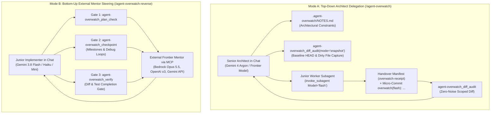

# 🛰️ Agent-Overwatch

> **The architectural oversight system for autonomous AI coding agents.**  
> Pair frontier reasoning models (Gemini 4 Argon, Claude Opus, OpenAI o3) with high-throughput execution models (Gemini 3.8 Flash, Claude Haiku, GPT-4o-mini) at strict architectural checkpoints.

[](https://github.com/faisalforreal/agent-overwatch/actions/workflows/ci.yml)
[](LICENSE)
[](https://modelcontextprotocol.io)
[](tests/)

---

## 💡 Why Agent-Overwatch?

High-throughput, cost-effective models (such as **Gemini 3.8 Flash**, **Claude 3.5 Haiku**, or **GPT-4o-mini**) are extraordinarily fast at editing files, running test suites, and handling mechanical coding chores. However, smaller models frequently struggle with architectural judgment:
- They hallucinate libraries and deprecated APIs.
- They miss subtle race conditions, error handling, and security implications.
- They thrash in endless debug loops without realizing they are stuck.
- Traditional `git diff` reviews often capture unrelated uncommitted files left in developer working trees, obscuring what the AI actually changed.

**Agent-Overwatch** introduces formal architectural oversight and scoped code isolation through two complementary operating modes.

---

## ⚡ The Two Operating Modes

Agent-Overwatch supports both **Top-Down Architect Delegation** (inside IDE environments like Google Antigravity at **$0 extra API cost**) and **Bottom-Up External API Steering** (for developers using Bedrock, Anthropic, or OpenAI API keys).



### Mode Comparison Matrix

| Feature | `agent-overwatch` (Top-Down Delegation) | `agent-overwatch-reverse` (Bottom-Up Steering) |
| :--- | :--- | :--- |
| **Primary Chat Role** | **Senior Staff Architect** (e.g. Gemini 4 Argon) | **Junior Implementer** (Gemini Flash, Haiku, Mini) |
| **Worker Execution** | Subagent (`invoke_subagent` with `Model="flash"`) | Primary Chat Agent directly edits files |
| **Architect Review** | In-chat audit of scoped diff against `NOTES.md` | External mentor review via 1-shot HTTP POST |
| **Self-Verification** | **None** (Senior Architect never self-checks) | Mandatory gates (`plan_check`, `checkpoint`, `verify`) |
| **Subagent Tool Use** | **Forbidden** (Subagent never calls overwatch tools) | N/A (single-agent workflow) |
| **Git Diff Isolation** | **Scoped Diff Audit** (`agent-overwatch_diff_audit`) | Unified diff / snippet inspection |
| **Commit Standard** | `overwatch(flash): <summary>` + `overwatch-receipt` | Standard workspace commits |
| **API Keys Needed** | **None** ($0 extra cost inside Antigravity) | Yes (`BEDROCK_API_KEY`, `ANTHROPIC_API_KEY`, etc.) |
| **Slash Command** | `/agent-overwatch` | `/agent-overwatch-reverse` |

---

## 🛡️ Eliminating Dirty Working Tree Bleed

A common pitfall in agentic coding is **diff contamination**: if a developer has uncommitted drafts or dirty files in their repository, running a broad `git diff HEAD` captures all of them, confusing the reviewer with unrelated changes.

Agent-Overwatch solves this with a **zero-noise scoped workflow**:

1. **Pre-Delegation Snapshot**:
   Before launching a subagent, the Senior Architect calls `agent-overwatch_diff_audit(mode="snapshot")` to capture the baseline commit and pre-existing dirty files.
2. **Subagent Micro-Commit Standard**:
   The junior subagent (`Model="flash"`) is instructed to stage **only** the files it touches:
   ```bash
   git add <file1> <file2>
   git commit -m "overwatch(flash): implement feature and tests"
   ```
3. **Handover Manifest (`overwatch-receipt`)**:
   Upon finishing, the subagent outputs a structured receipt and hands over control immediately:
   ````yaml
   ```overwatch-receipt
   commit: "a1b2c3d"
   touched_files:
     - "src/auth/jwt.ts"
     - "tests/auth.test.ts"
   test_status: "PASSED (all 8 tests pass)"
   summary: "Added token validation with expiry checks"
   ```
   ````
4. **Scoped Diff Audit**:
   The Senior Architect passes `files` and `base_commit` to `agent-overwatch_diff_audit`. The server executes `git diff <base>..<target> -- <files>`, extracting **only** the subagent's changes and completely ignoring uncommitted developer files.

---

## 🧰 Complete MCP Tools Reference

Agent-Overwatch exposes **7 specialized Model Context Protocol (MCP) tools**:

| Tool Name | Purpose | Primary Mode |
| :--- | :--- | :--- |
| **`agent-overwatch_diff_audit`** | Captures pre-delegation snapshot baselines and produces scoped diffs strictly for subagent-touched files, eliminating dirty tree noise. | Top-Down (`agent-overwatch`) |
| **`agent-overwatch_plan_check`** | Reviews architectural breakdowns, locks decisions into `.agent-overwatch/NOTES.md`, and validates system constraints. | Bottom-Up (`agent-overwatch-reverse`) |
| **`agent-overwatch_checkpoint`** | Evaluates progress between milestones, checks for race conditions, and breaks agents out of 2+ failure debug loops. | Bottom-Up (`agent-overwatch-reverse`) |
| **`agent-overwatch_review`** | Performs deep code review on diffs with 1-hop module dependencies, untracked files, and secret scrubbing. | Both modes |
| **`agent-overwatch_quick_hint`** | Targeted diagnosis for compiler errors, failed assertions, or cryptic framework stack traces. | Both modes |
| **`agent-overwatch_verify`** | Final release gate verifying unified git diff and test suite output before declaring a task complete. | Bottom-Up (`agent-overwatch-reverse`) |
| **`agent-overwatch_status`** | Diagnostics tool inspecting active operating mode, configured mentor and junior models, latency, and session budget. | Diagnostic / Both modes |

---

## 🚀 Quickstart & Setup

Install and configure Agent-Overwatch across any supported AI coding client in seconds:

```bash
# Automated setup for Google Antigravity
npx agent-overwatch setup --client antigravity

# Or install across all detected AI tools at once
npx agent-overwatch setup --client all
```

### Supported Clients

| Client | Configuration Path | Skill & Rules Path | Status |
| :--- | :--- | :--- | :--- |
| **Google Antigravity** | `~/.gemini/config/mcp_config.json` | `~/.gemini/config/skills/agent-overwatch/` & `AGENTS.md` | ✅ Tested & Supported |
| **Claude Code** | `~/.claude.json` (`mcpServers`) | `~/.claude/skills/agent-overwatch/` & `CLAUDE.md` | ✅ Tested & Supported |
| **Cursor** | `~/.cursor/mcp.json` | `.cursor/rules/agent-overwatch.mdc` | ✅ Tested & Supported |
| **Windsurf** | `~/.codeium/windsurf/mcp_config.json` | `.windsurf/rules/agent-overwatch.md` | ✅ Tested & Supported |
| **VS Code (Cline)** | `cline_mcp_settings.json` | Workspace `.clinerules` | ✅ Tested & Supported |
| **Codex** | `~/.codex/config.toml` | Workspace `AGENTS.md` | ✅ Tested & Supported |

### Local Development Mode

When contributing to or extending Agent-Overwatch, compile and link locally:

```bash
git clone https://github.com/faisalforreal/agent-overwatch.git
cd agent-overwatch
npm install
npm run build
node bin/agent-overwatch.js setup --client antigravity --local
```

Any changes compiled via `npm run build` take effect immediately upon the next MCP tool call.

---

## ⚙️ Provider Configuration (For Bottom-Up Mode)

Run the interactive setup wizard to configure your preferred external mentor model:

```bash
npx agent-overwatch configure
```

### Supported Mentor Backends

1. **Google Antigravity (Local / $0 Extra Cost)**:
   ```json
   {
     "mentorProvider": "antigravity",
     "mentorModel": "gemini-4-argon",
     "juniorModel": "gemini-3.8-flash"
   }
   ```
2. **OpenRouter**:
   Access Claude Opus, Gemini Argon, OpenAI o3, or DeepSeek R1 with a single key:
   ```bash
   export OPENROUTER_API_KEY="sk-or-v1-..."
   ```
3. **AWS Bedrock (Bearer Token or SigV4)**:
   Access Claude 3.7 Sonnet or Claude Opus on Amazon Bedrock without AWS SDK dependencies:
   ```bash
   export BEDROCK_API_KEY="your-bedrock-api-key"
   export AWS_REGION="us-east-1"
   ```
4. **Direct Anthropic**:
   ```bash
   export ANTHROPIC_API_KEY="sk-ant-..."
   ```
5. **Direct OpenAI**:
   ```bash
   export OPENAI_API_KEY="sk-..."
   ```
6. **Direct Google Gemini**:
   ```bash
   export GEMINI_API_KEY="AIzaSy..."
   ```
7. **Custom / OpenAI-Compatible Endpoints** (Ollama, LM Studio, vLLM, DeepSeek API):
   ```bash
   export CUSTOM_BASE_URL="http://localhost:11434/v1"
   export CUSTOM_MODEL="deepseek-r1:70b"
   ```

---

## 🔍 Diagnostics & Health Check

Run the comprehensive diagnostics suite to check your configuration, model tiers, and latency:

```bash
npx agent-overwatch doctor
```

```text
🛰️  Agent-Overwatch Diagnostic Report
─────────────────────────────────────────────
Operating Mode:     Top-Down Architect Delegation (antigravity)
Senior Mentor:      gemini-4-argon (Tier: frontier)
Junior Worker:      gemini-3.8-flash (Tier: medium)
Tier Relationship:  ✅ Mentor outranks worker (frontier > medium)
Working Tree:       ✅ Clean isolation ready
MCP Protocol:       ✅ stdio JSON-RPC healthy
```

---

## 🔒 Privacy, Safety & Telemetry

- **Zero Telemetry**: No usage metrics, error telemetry, or tracking are collected.
- **Automatic Secret Scrubbing**: All outgoing tool payloads pass through [`src/context/redactor.ts`](src/context/redactor.ts), redacting AWS keys, GitHub PATs, JWTs, private keys, and bearer tokens.
- **Directory Traversal Protection**: File readers enforce boundary checks and symlink resolution, preventing path traversal outside the repository root.
- **Safe Environment Guard**: `.env`, `.env.*`, `*.pem`, `*.key`, and `id_rsa` files are strictly excluded from context gathering.

---

## 🧪 Testing & Verification

The test suite covers unit and integration tests across providers, tier validation, diff scoping, and MCP transport:

```bash
npm test
```

```text
Test Files  23 passed (23)
     Tests  112 passed (112)
```

---

## 📜 License

MIT © 2026 Agent-Overwatch Contributors.
